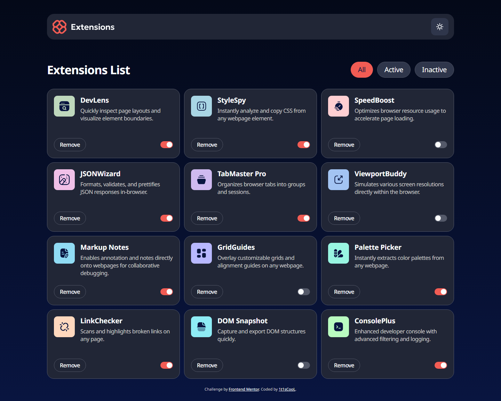
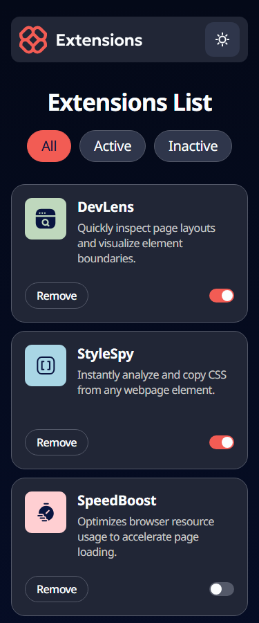

# Frontend Mentor - Browser extensions manager UI solution

This is a solution to the [Browser extensions manager UI challenge on Frontend Mentor](https://www.frontendmentor.io/challenges/browser-extension-manager-ui-yNZnOfsMAp). Frontend Mentor challenges help you improve your coding skills by building realistic projects.

## Table of contents

- [Overview](#overview)
  - [The challenge](#the-challenge)
  - [Screenshot](#screenshot)
  - [Links](#links)
- [My process](#my-process)
  - [Built with](#built-with)
  - [What I learned](#what-i-learned)
  - [Continued development](#continued-development)
  - [Useful resources](#useful-resources)
- [Development](#development)
- [Author](#author)

## Overview

### The challenge

Users should be able to:

- Toggle extensions between active and inactive states
- Filter active and inactive extensions
- Remove extensions from the list
- Select their color theme
- View the optimal layout for the interface depending on their device's screen size
- See hover and focus states for all interactive elements on the page

### Screenshot

| Desktop                              | Mobile                             |
| ------------------------------------ | ---------------------------------- |
|  |  |

### Links

- Solution URL: [Vercel](https://browser-extensions-manager-ui-main-mu.vercel.app/)
- Live Site URL: [mmalabugin.ru/BrowserExtensionsManagerUI](https://mmalabugin.ru/BrowserExtensionsManagerUI/)

## My process

### Built with

- **[Marko 6](https://markojs.com/) + [@marko/run](https://github.com/marko-js/run)** (Vite 8, TypeScript) — this challenge's new framework. The static adapter prerenders `/` into `dist/public/index.html`, so the full list of twelve cards is in the HTML before any JavaScript runs. Marko 6 is *resumable*: instead of hydrating the whole tree it serializes the state the handlers need (`extensions`, `filter`) into the page and only wires the event handlers. The whole client bundle is about 13 kB.
- **FSD layout.** `@marko/run` owns `src/routes` (the document shell and the single page). Slices live next to it: `pages/extensions-manager`, `widgets` (`app-header`, `extensions-board`), `features` (`filter-extensions`, `toggle-theme`), `entities/extension`, `shared` (logo, icons, toggle switch, asset URLs).
- **Pure model, thin templates.** Toggling, removing, filtering, the theme and the screen-reader announcements are plain TypeScript functions (`setExtensionActive`, `removeExtension`, `filterExtensions`, `restoreTheme`, …). The `.marko` files only hold `<let>` state and call them, so Vitest covers the logic without a DOM.
- **No theme flash.** A tiny inline script in `<head>` reads `localStorage` (falling back to `prefers-color-scheme`) and sets `data-theme` on `<html>` before the first paint. The same `restoreTheme` function is unit-tested and then serialized into the page with `Function#toString`, so there is one implementation, not two.
- **Theme via CSS custom properties.** Every color in the components is a semantic token (`--surface`, `--accent`, `--ring`, …) that `[data-theme="dark"]` / `[data-theme="light"]` remaps. The logo and the sun/moon icons are inlined SVG with `currentColor`, so the wordmark turns white in the dark theme without a second image.
- **Accessibility.** Native `<input type="checkbox" role="switch">` for each extension, `aria-pressed` filter buttons inside a labelled group, cards as `<article>` labelled by their heading, `aria-label="Remove DevLens"` that still contains the visible text, a polite `role="status"` region that announces toggles and removals, and `:focus-visible` rings that match the focus comps (2px ring, 2px offset).
- **Performance.** The Noto Sans variable font is instanced to the 400–700 weight range and subset to Latin with `fonttools`: one **17 kB** woff2 instead of three 630 kB TTFs. It is preloaded from the same URL the `@font-face` uses, with `font-display: optional`, so there is no swap layout shift.
- Desktop-first CSS with `em` media queries, `rem` sizes, logical properties, and motion only inside `@media (prefers-reduced-motion: no-preference)`.

### What I learned

- **Marko 6 state is just variables.** `<let/filter="all">` declares state, plain assignment (`filter = "active"`) updates it, and `<const/visible=filterExtensions(extensions, filter)>` recomputes on its own. Arrays have to be reassigned, never mutated — which is exactly what the pure model functions return anyway.
- **Controllable components with `:=`.** `<FilterTabs value:=filter/>` passes both `value` and `valueChange`. Inside, `<let/value:=input.value>` makes the tag controlled when the parent binds it and self-managed when it does not, so the unit test can render it alone.
- **The design uses tracking that the style guide does not mention.** At the same cap height, the Figma text was ~5% narrower than Chrome's rendering, and the description lines wrapped one word earlier. Measuring `Range` widths at different `letter-spacing` values against the JPG ink widths gave −0.5px for body copy, −0.6px for "Remove", about −0.35px for the filter pills and −1px for the 34px heading. After that the line breaks match the comps exactly.
- **Measure, then diff.** A Playwright script renders 1440×1156 and 375×2862, compares element boxes and text ink boxes with the JPGs, and writes a difference image. The desktop diff ended at ~1% of pixels (anti-aliasing edges), mobile ~2%.
- **`@marko/run` respects Vite's `base`.** Uncommenting `base: "/BrowserExtensionsManagerUI/"` prefixes the CSS, JS, favicon, card logos and the `url()` inside `@font-face`; `assetUrl()` builds the remaining public paths from `import.meta.env.BASE_URL`, so preload and `@font-face` stay identical on both branches.

### Continued development

- A confirmation dialog before removing an extension, with an undo toast.
- Persisting extension state between visits.

### Useful resources

- [Marko 6 docs](https://markojs.com/docs/introduction) — tags API, `<let>`, `<const>`, `<lifecycle>`.
- [@marko/run](https://github.com/marko-js/run) — file-based routing and adapters.
- [Feature-Sliced Design](https://feature-sliced.design/) — where the route stops and the slices start.

## Development

```bash
npm install
npm run dev       # marko-run dev server
npm run test      # vitest: unit + integration
npm run build     # static prerender → dist/public
```

Deploy convention: `main` targets **Vercel** (`base` stays commented, the site is served from `/`). The `deploy` branch uncomments `base: "/BrowserExtensionsManagerUI/"` in `vite.config.ts`. Jenkins builds that branch into an nginx image and Kubernetes serves it at `mmalabugin.ru/BrowserExtensionsManagerUI/`.

## Author

- Website - [mmalabugin.ru](https://mmalabugin.ru/)
- Frontend Mentor - [@1t1sCooL](https://www.frontendmentor.io/profile/1t1sCooL)
- Twitter - [@vi_el_mar](https://www.twitter.com/vi_el_mar)
- Telegram - [@ItIsCooL](https://t.me/ItIsCooL)
